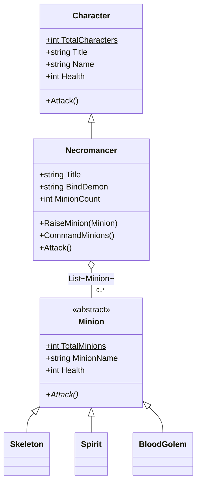
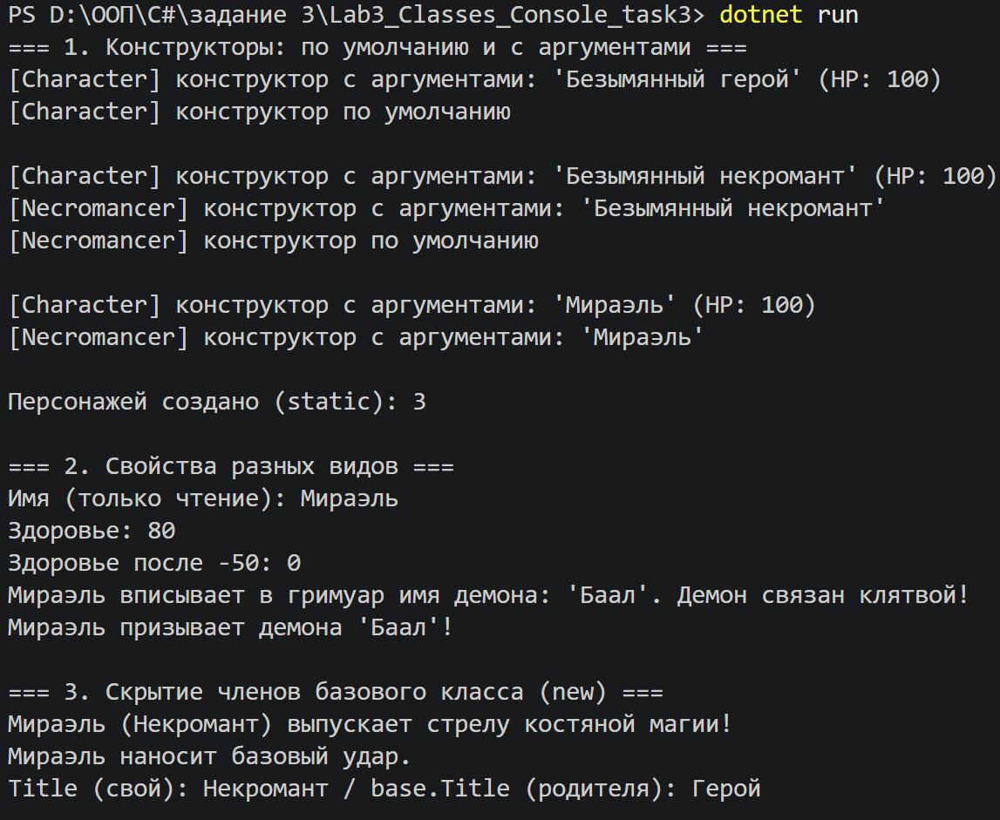
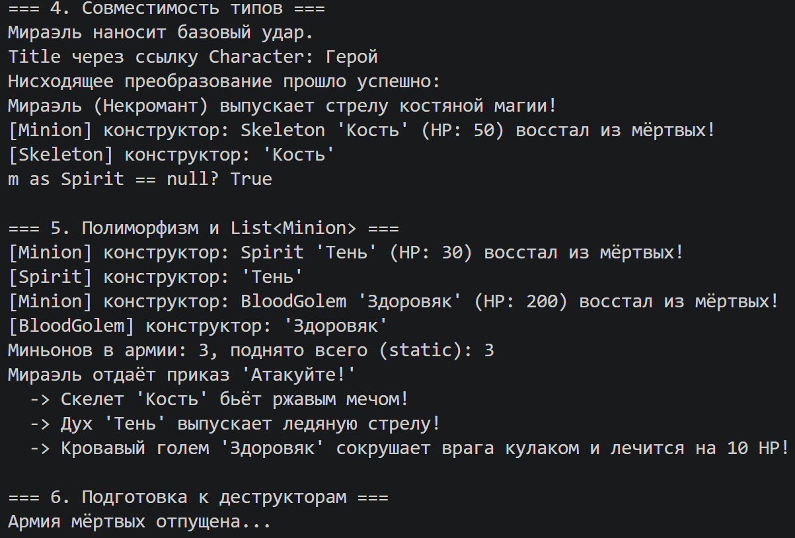
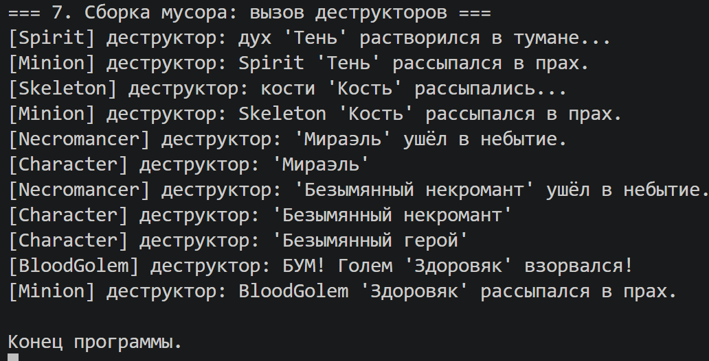

# Лабораторная работа №3: Основы ООП (Классы, Наследование, Полиморфизм)

> Язык: C# · Платформа: .NET 10 · Тип проекта: консольное приложение
>
> Автор: _ФИО_ · Группа: _номер_ · Курс: _название дисциплины_ · СГУ им. Н. Г. Чернышевского, 2025

**Предметная область:** небольшой кусочек игровой вселенной (вдохновлено горячо любимой Diablo 2).

*Почему выбрана эта тема?* Классические примеры (геометрия или животные) слишком просты, а геометрия уже рассматривалась в двух прошлых заданиях.

Игровые сущности (персонаж и его прислужники) позволили наглядно продемонстрировать все требования методички (наследование, абстракцию, полиморфизм и работу с памятью) на понятной и логичной архитектуре. И надо отметить, что это было приятнее и интереснее. Хотя с животными тоже могло выйти интересно, т.к. можно было брать мифических существ.

## Реализованная архитектура

В проекте реализована следующая иерархия:

1. **`Character` (базовый класс)** — представляет обычного персонажа.
2. **`Necromancer` (наследник `Character`)** — представляет некроманта, который может призывать нежить.
3. **`Minion` (абстрактный класс)** — базовый класс для всех прислужников.
4. **`Skeleton`, `Spirit`, `BloodGolem` (наследники `Minion`)** — конкретные виды нежити с уникальным поведением.



---

## Как выполнены требования методички (задания 2.2 и 3.2)

Вся демонстрация находится в методе `RunDemo()` класса `Program`, а вывод сборки мусора — в `Main`.

### 1. Конструкторы
- У `Character` и `Necromancer` есть и **конструктор по умолчанию**, и **конструктор с аргументами**. У `Minion` и его наследников — конструкторы с аргументами.
- Конструкторы по умолчанию передают управление другому конструктору своего же класса через `: this(...)`.
- Конструкторы наследников (`Necromancer`, `Skeleton`, `Spirit`, `BloodGolem`) вызывают конструкторы родительских классов через `: base(...)`.
- Каждый конструктор выводит сообщение о своём вызове.

### 2. Статические поля
- В классе `Character` есть статическое свойство `TotalCharacters` (счётчик всех созданных персонажей).
- В классе `Minion` есть статическое свойство `TotalMinions` (счётчик всех поднятых прислужников).
- Оба имеют `private set`, поэтому менять их можно только внутри класса.
- В `RunDemo()` продемонстрирован вывод этих счётчиков.

### 3. Поле-экземпляр параметризованного класса
- В классе `Necromancer` есть поле `private readonly List<Minion> _minions`. Это параметризованный класс (generic), хранящий армию нежити.

### 4. Свойства разных видов
- **Только для чтения (только `get`):** `Name` в классе `Character` (задаётся при создании и не меняется), а также вычисляемое свойство `MinionCount` в классе `Necromancer`.
- **Только для записи (только `set`):** `BindDemon` в классе `Necromancer`. Истинное имя демона вписывается в гримуар, но прочитать его обратно нельзя (чтобы демон не вырвался). Сохранённое имя использует метод `SummonDemon()`.
- **Для чтения и записи (`get` и `set`):** `Health` в классах `Character` и `Minion`. В сеттере реализована **валидация** (здоровье не может уйти в минус).

### 5. Скрытие членов базового класса (`new`)
- В классе `Character` поле `Title` и метод `Attack` **не являются виртуальными**.
- В классе `Necromancer` они скрыты с помощью ключевого слова `new` (своё поле `Title` и свой метод `Attack`).
- Доступ к скрытым членам из потомка выполняется через `base.Attack()` и `base.Title` (методы `AttackHiddenBase()` и `ShowTitles()`).
- В `RunDemo()` показано, что при вызове через ссылку `Character` срабатывает метод базового класса, а через ссылку `Necromancer` — скрытый. Это отличает скрытие (`new`) от переопределения (`override`).

### 6. Совместимость типов (upcasting / downcasting)
- **Восходящее преобразование:** `Character baseRef = necro;` (безопасно, неявно).
- **Нисходящее преобразование:** проверка `if (baseRef is Necromancer castedNecro)`.
- **Оператор `as`:** безопасное приведение, которое может вернуть `null` (`m as Spirit` для скелета).
- Через ссылку базового типа доступны только члены базового класса (например, `baseRef.CommandMinions()` не скомпилируется). Такие строки оставлены в коде в виде комментариев.

### 7. Полиморфизм (виртуальные методы и абстракция)
- Класс `Minion` — **абстрактный** (`abstract`). Нельзя создать объект «просто миньон».
- Метод `Attack()` в `Minion` помечен как `virtual`, а в наследниках (`Skeleton`, `Spirit`, `BloodGolem`) переопределён через `override`.
- В цикле `foreach (Minion minion in _minions)` вызывается `minion.Attack()`. Благодаря полиморфизму каждый миньон атакует по-своему (скелет бьёт мечом, голем — кулаком и лечится).

### 8. Деструкторы и работа с памятью
- Во всех классах реализованы деструкторы (финализаторы), каждый выводит сообщение.
- Сборщик мусора (Garbage Collector) в C# вызывает деструкторы в непредсказуемый момент. Чтобы показать их работу, демонстрация вынесена в метод `RunDemo()` с атрибутом `[MethodImpl(MethodImplOptions.NoInlining)]`.
- После выхода из `RunDemo()` локальных ссылок на объекты не остаётся, поэтому вызов `GC.Collect()` и `GC.WaitForPendingFinalizers()` в `Main` как правило собирает объекты и выводит сообщения деструкторов.

---

## Что стоит заметить в выводе

- **Порядок конструкторов.** При создании `new Necromancer()` сначала выводится сообщение конструктора с аргументами и только потом «по умолчанию»: вызов `this(...)` выполняется раньше тела конструктора по умолчанию. Цепочка идёт сверху вниз: `Character` → `Necromancer (с аргументами)` → `Necromancer (по умолчанию)`.
- **Порядок деструкторов.** Между разными объектами порядок не определён (его выбирает сборщик мусора), поэтому у каждого запуска он может отличаться. Внутри одного объекта порядок фиксированный: сначала деструктор наследника, потом базового (например, `Spirit` → `Minion`).
- **`new` и `override`.** `baseRef.Attack()` вызывает версию `Character`, потому что метод скрыт, а не переопределён. У миньонов, наоборот, срабатывает версия наследника (полиморфизм).

---

## Демонстрация работы

**1–3. Конструкторы, свойства, скрытие членов базового класса**



**4–6. Совместимость типов, полиморфизм, подготовка к деструкторам**



**7. Сборка мусора: вызов деструкторов**



## Как запустить

Нужен [.NET 10 SDK](https://dotnet.microsoft.com/download) (версия указана в `Lab3_Classes_Console_task3.csproj`).

```bash
git clone https://github.com/Lynastra/Lab3_OOP_Classes_Necromancer.git
cd Lab3_OOP_Classes_Necromancer
dotnet run
```
